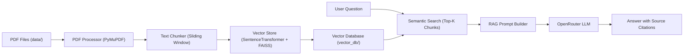

# PDF-Based Question Answering System (RAG)

A Retrieval-Augmented Generation (RAG) system for question-answering over PDF documents. It uses semantic vector search with FAISS and Sentence Transformers to retrieve relevant context from PDFs and synthesizes accurate, citation-backed answers using an LLM via OpenRouter.

---

## Architecture & Workflow



1. **PDF Processing (`pdf_processor.py`)**:
   - Extracts page-by-page text from all PDF files stored in the `data/` directory using `PyMuPDF`.
   - Tracks source filename and page number with every extracted text segment.

2. **Text Chunking (`chunker.py`)**:
   - Splits document text into chunks (default 100 words with 20-word overlap) to preserve local semantic context across chunk boundaries.

3. **Vector Storage & Retrieval (`vector_store.py`)**:
   - Converts text chunks into 384-dimensional dense embeddings using `sentence-transformers/all-MiniLM-L6-v2`.
   - Indexes embeddings using FAISS (`IndexFlatIP` with normalized vectors for cosine similarity).
   - Persists FAISS index (`faiss.index`) and chunks metadata (`chunks.pkl`) in `vector_db/` for instant reloading.

4. **RAG Pipeline (`rag_pipeline.py`)**:
   - Encodes user queries and searches the FAISS index for the top matching chunks.
   - Applies a minimum retrieval similarity threshold (`MIN_RETRIEVAL_SCORE = 0.35`) to avoid hallucinations on out-of-domain questions.
   - Formulates a grounded prompt with system constraints and queries the LLM via OpenRouter.

5. **Web UI & REST API (`api.py` / `app.py`)**:
   - Provides an interactive web interface at `/` with sample questions, live search, and citation badges.
   - Exposes REST endpoints (`/health`, `/ask`) for programmatic access.

---

## Installation & Setup

### 1. Prerequisites
- Python 3.10+
- An [OpenRouter API Key](https://openrouter.ai/)

### 2. Install Dependencies
```bash
pip install -r requirements.txt
```

### 3. Environment Configuration
Create a `.env` file in the project root:
```env
OPENROUTER_API_KEY="your-openrouter-api-key"
# Optional: customize model (defaults to nvidia/nemotron-3-ultra-550b-a55b:free)
OPENROUTER_MODEL="nvidia/nemotron-3-ultra-550b-a55b:free"
```

---

## Running the Application

### Option A: Web Interface & API Server (Recommended)
```bash
python app.py
```
Open **http://127.0.0.1:5000** in your browser.

### Option B: Command-Line RAG Pipeline
```bash
python rag_pipeline.py
```

---

## REST API Endpoints

### 1. Health Check
- **Endpoint**: `GET /health`
- **Response**:
```json
{
  "status": "API is running successfully"
}
```

### 2. Ask a Question
- **Endpoint**: `POST /ask`
- **Headers**: `Content-Type: application/json`
- **Body**:
```json
{
  "question": "What is supervised learning?"
}
```
- **Response**:
```json
{
  "answer": "Supervised learning is a type of machine learning where a model learns from labelled examples...",
  "sources": [
    {
      "source": "sample.pdf",
      "page": 1
    },
    {
      "source": "An_Introduction_to_Statistical_Learning_with_Applications_in_Python.pdf",
      "page": 35
    }
  ]
}
```

---

## Project Structure

```
PDF-Based Question Answering System/
├── data/                    # PDF documents
├── templates/
│   └── index.html           # Web UI template
├── vector_db/               # Saved FAISS index & metadata
├── .env                     # API keys and environment variables
├── .gitignore               # Git ignored patterns
├── api.py                   # Flask server and API endpoints
├── app.py                   # Server entry point
├── chunker.py               # Text chunking logic
├── pdf_processor.py         # PDF text extraction
├── rag_pipeline.py          # RAG retrieval and LLM prompt logic
├── requirements.txt         # Project dependencies
├── vector_store.py          # FAISS indexing and vector persistence
└── README.md                # Project documentation
```

